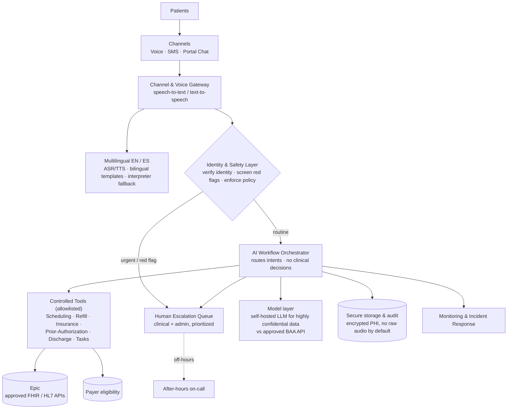

# Architecture Diagram — Larkspur Health Patient Communication System

Linked from **Section C** of [`APPROACH.md`](./APPROACH.md). Kept deliberately simple: one
left-to-right path from patient channels to the backend, with safety and human escalation as
first-class gates. An editable draw.io copy is in
[`architecture-diagram.drawio`](./architecture-diagram.drawio).

## What to read in the diagram

- **Channels** — voice, SMS, and portal chat converge on one gateway, so policy is enforced once.
- **Identity & Safety Layer** — a gate that runs *before* any workflow: verifies identity, screens
  for red-flag symptoms, and enforces consent/disclosure rules.
- **Orchestrator + Controlled Tools** — the LLM understands language, but only allowlisted tools
  touch records; the AI never diagnoses or prescribes.
- **Model layer** — highly confidential data stays on a **self-hosted LLM**; only lower-sensitivity
  workloads may use approved API models (see Section A Q12 / Section C).
- **Backend** — Epic and payer systems via approved interfaces; secure encrypted storage and audit.
- **Human escalation** — urgent and unresolved cases go straight to staff, with after-hours fallback;
  nothing dead-ends silently.
